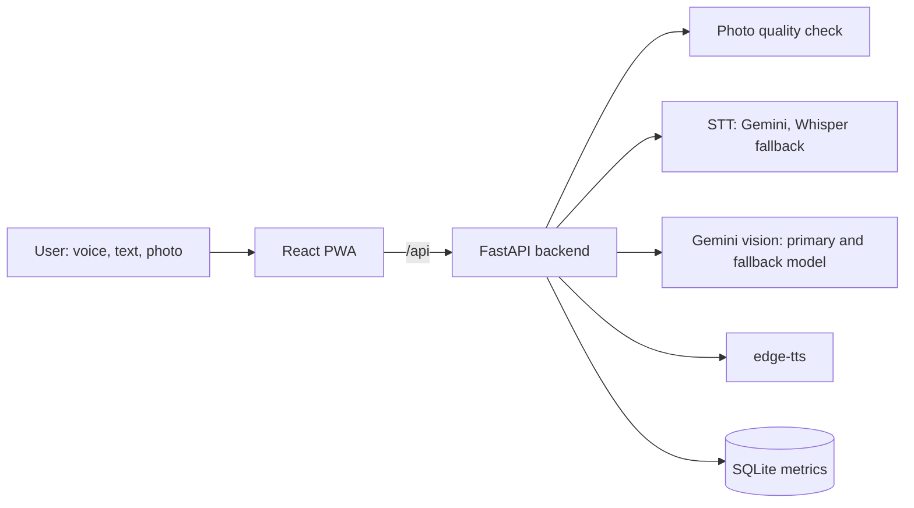

# Voice Vision Assistant

A voice-first web assistant (installable PWA) that describes photos for visually impaired users. The user speaks or types, sends a photo (file, camera, drag and drop, paste) and hears a short, accurate answer in Arabic, French or English. Follow-up questions about the same photo are supported.

Final year project. Free tools only (Gemini free tier, edge-tts, faster-whisper, React, FastAPI).

## Features

- Modes: describe, read text (OCR), product, currency (MAD), find an object. Brief or detailed answers.
- Photo quality feedback: a blurry or dark photo is not sent to the model; the user hears retake advice instead.
- Conversation memory per session (in memory, with a time limit).
- Speech in and out: Gemini speech-to-text (Whisper small as fallback), edge-tts voices, browser speech as last resort.
- Accessibility: keyboard shortcuts, screen reader announcements (aria-live), skip link, high contrast, RTL layout for Arabic.
- Jury mode: live latency panel with p50/p95, perceived wait, voice vs text split and a per-request chart.

## Architecture



## Requirements

- Windows with PowerShell (commands below use it). Other systems should work but are untested.
- Python 3.11, Node.js 24 (what the project was built with), Git.
- ffmpeg on PATH (the backend converts recorded audio before speech-to-text).
- A free Gemini API key from Google AI Studio.
- Internet access: vision, speech-to-text and voices all call online services.

## Setup

Backend (from the project root):

```powershell
cd backend
py -3.11 -m venv .venv
.\.venv\Scripts\Activate.ps1
pip install -r requirements.txt
Copy-Item .env.example .env
# open .env and set GEMINI_API_KEY=your key (never commit this file)
uvicorn app.main:app --reload
```

Frontend (second terminal, from the project root):

```powershell
cd frontend
npm install
npm run dev
```

Open http://localhost:5173. The dev server proxies `/api` to http://127.0.0.1:8000.

Notes:
- `uvicorn --reload` does not reload `.env`: restart the server after editing it.
- The first use of the Whisper fallback downloads its model.
- The service worker (offline app shell) only exists in a production build: `npm run build` then `npm run preview` (http://localhost:4173).

## Tests

```powershell
cd backend
.\.venv\Scripts\Activate.ps1
python -m pytest -q
```

There are no frontend tests; `npm run build` runs the TypeScript check.

## Keyboard shortcuts

They use physical key codes, so they also work on Arabic and AZERTY layouts. They are ignored while typing or when a dialog is open.

| Key | Action |
|---|---|
| Space | Start or stop recording |
| Esc | Cancel recording or stop speaking |
| P | Choose a photo |
| C | Open the camera |
| R | Repeat the last answer |
| T | Focus the question field |
| 1 to 5 | Choose a mode |
| L | Cycle language (English, French, Arabic) |
| N | New conversation |
| H | Help |
| J | Show or hide Jury mode |

## API summary

| Endpoint | Purpose |
|---|---|
| `GET /api/health`, `GET /api/modes` | Status and available modes |
| `POST /api/quality` | Photo quality check with advice |
| `POST /api/describe` | Single-shot description (older endpoint) |
| `POST /api/stt` | Speech to text |
| `POST /api/tts` | Text to speech (mp3) |
| `POST /api/session`, `GET/DELETE /api/session/{id}` | Conversation sessions |
| `POST /api/ask` | Main endpoint: text or audio, optional photo |
| `GET /api/metrics/summary`, `GET /api/metrics/recent` | Latency metrics used by Jury mode |

## Configuration

Everything is set in `backend/.env` (see `backend/.env.example`). Only Gemini is implemented as a vision provider; the Mistral, Cloudflare and Ollama entries are placeholders for future work.

Main options: `GEMINI_API_KEY`, `GEMINI_MODEL`, `GEMINI_FALLBACK_MODEL`, `STT_ENGINE` (`gemini` or `whisper`), `GEMINI_RPM_LIMIT`, `TTS_VOICE_EN/FR/AR`, `MAX_IMAGE_SIDE`, `MAX_UPLOAD_MB`.

## Free tier limits

- `gemini-3.5-flash-lite` showed 15 requests per minute and 500 requests per day in Google AI Studio (read on 2026-10-18; check your own quota). The app keeps a margin by limiting itself to 12 requests per minute.
- A voice turn costs two Gemini requests (speech-to-text, then vision); a text turn costs one.
- Gemini free-tier data may be used by Google for product improvement: do not send private photos.

## Measured performance

One machine, one speaker, free tier, server-side time (it does not include silence detection or the time until the voice starts):

| Input | Samples | Median | 95th percentile | Within 4 s |
|---|---|---|---|---|
| Text | 40 | 1.9 s | 3.2 s | 100% |
| Voice | 19 | 6.2 s | 12.7 s | 10.5% |

Voice turns are slower mainly because of speech-to-text (median 3.9 s in the same sample). A controlled test with a fixed clip gave a flat 2.0 to 2.3 s for the Gemini call, so the slow field requests are not explained yet.

## Known limitations

- Voice turns usually exceed the 4 s target; time to first sound is about 1.5 s.
- Sessions are stored in memory and are lost when the server restarts.
- The rate limiter only guards `/api/ask`, not `/api/describe` or `/api/stt` called directly.
- Windows browsers usually have no Arabic voice, so server-side voices (internet required) are used.
- Speech-to-text was tested with one speaker.
- The benchmark is small and not clinical, and the usability study uses sighted participants.

## Project structure

```
backend/    FastAPI app (app/), scripts/ (benchmarks, manifest tools), tests/
frontend/   React 19 + Vite + Tailwind, react-i18next (en, fr, ar), Zustand
docs/       Documentation
```
